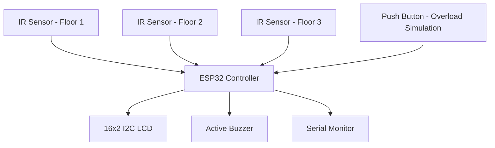

# ESP32-Based Elevator Monitoring System

A low-cost educational prototype that monitors a three-floor elevator model using IR sensors and demonstrates an overload alert using a push button.

> **Project scope:** This repository documents the prototype that was assembled: three IR floor sensors, a push-button overload simulation, an active buzzer, a 16×2 I²C LCD, and an ESP32. It is not a certified elevator controller and must not be connected to or used to control a passenger lift.

## Features

- Three-floor position indication using three digital IR sensor modules.
- Current floor displayed on a 16×2 I²C LCD.
- Push-button overload simulation.
- Audible overload indication using an active buzzer.
- Second button press clears the simulated overload alert.
- Serial Monitor status output for debugging.

## Hardware

| Component | Quantity | Role |
|---|---:|---|
| ESP32 development board | 1 | Main controller |
| Digital IR sensor module | 3 | Floor-position detection |
| Momentary push button | 1 | Simulated overload input |
| Active buzzer module | 1 | Overload sound alert |
| 16×2 LCD with I²C backpack | 1 | Floor and alert display |
| Breadboard and jumper wires | As needed | Prototyping connections |
| USB cable / suitable supply | 1 | ESP32 power and programming |

The prototype does **not** currently contain a load cell, HX711 amplifier, servo motor, door sensor, or implemented Wi-Fi/cloud dashboard. These are possible future extensions, not current features.

## System block diagram



## Wiring

| Module | Signal / Pin | ESP32 connection |
|---|---|---|
| IR sensor 1 | OUT | GPIO 13 |
| IR sensor 1 | VCC | 3.3 V |
| IR sensor 1 | GND | GND |
| IR sensor 2 | OUT | GPIO 14 |
| IR sensor 2 | VCC | 3.3 V |
| IR sensor 2 | GND | GND |
| IR sensor 3 | OUT | GPIO 27 |
| IR sensor 3 | VCC | 3.3 V |
| IR sensor 3 | GND | GND |
| Push button | One terminal | GPIO 26 |
| Push button | Other terminal | GND |
| Active buzzer | + | GPIO 25* |
| Active buzzer | − | GND |
| LCD I²C | SDA | GPIO 21 |
| LCD I²C | SCL | GPIO 22 |
| LCD I²C | VCC | 5 V** |
| LCD I²C | GND | GND |

* If the buzzer draws more current than the ESP32 GPIO can safely supply, drive it through a transistor/MOSFET stage instead of directly from the pin.  
** Confirm that the LCD backpack's I²C pull-ups do not pull SDA/SCL above the ESP32's 3.3 V logic limit. Use a bidirectional I²C level shifter or suitable 3.3 V pull-ups if required. All modules must share a common ground.

See [hardware/wiring-and-components.md](hardware/wiring-and-components.md) and [hardware/pinout.csv](hardware/pinout.csv).

## Software setup

1. Install Arduino IDE.
2. Install the **ESP32 by Espressif Systems** board package using Boards Manager.
3. Select the matching ESP32 board and its serial port.
4. Install a compatible **LiquidCrystal_I2C** library through Library Manager.
5. Open `src/elevator_monitoring.ino`.
6. Confirm the LCD I²C address (the project code is configured for `0x27`; scan the bus if the display does not respond).
7. Upload and open Serial Monitor at **115200 baud**.

The Arduino `Wire` library is included with the ESP32 Arduino core.

## Operation

- When an IR module detects its floor marker, the corresponding floor is shown on the LCD.
- The sketch assumes the IR modules are **active LOW** (OUT becomes LOW when a marker is detected). Adjust the sensor module potentiometers and/or change the active level in the sketch if your modules behave differently.
- Press the push button once to activate the simulated overload warning and buzzer.
- Press it again to clear the warning and return to floor display.
- If no floor sensor is active, the last detected floor is retained.

## Repository layout

```text
.
├── README.md
├── src/
│   └── elevator_monitoring.ino
├── hardware/
│   ├── pinout.csv
│   └── wiring-and-components.md
├── docs/
│   ├── algorithm.md
│   ├── system-architecture.md
│   ├── design-decisions.md
│   ├── testing.md
│   ├── future-scope.md
│   └── contribution-and-ai-disclosure.md
├── media/
│   └── README.md
└── .gitignore
```

## Limitations and safety

- The push button simulates an overload event; it does not measure passenger weight.
- Floor detection depends on correct sensor alignment, marker placement, and sensor calibration.
- This is a tabletop/educational monitoring prototype only. It does not implement motor control, braking, interlocks, emergency circuits, or any safety-rated elevator function.
- Do not use this prototype in a real elevator or as a substitute for certified lift safety equipment.

## Documentation

- [Algorithm](docs/algorithm.md)
- [System architecture](docs/system-architecture.md)
- [Design decisions](docs/design-decisions.md)
- [Testing checklist](docs/testing.md)
- [Future scope](docs/future-scope.md)
- [Contribution and AI disclosure](docs/contribution-and-ai-disclosure.md)

## Contributions and AI disclosure

The student assembled the prototype, selected and connected the available hardware, tested the LCD and sensors, and defined the required demonstration behavior. AI assistance was used to help organize documentation and refine the Arduino sketch. The disclosure document separates these roles; it does not claim independent authorship of AI-assisted text or code.

## License

No license file has been added because the repository owner has not specified a license. Until a license is chosen, the default copyright rules apply; do not assume the code is open for reuse.
