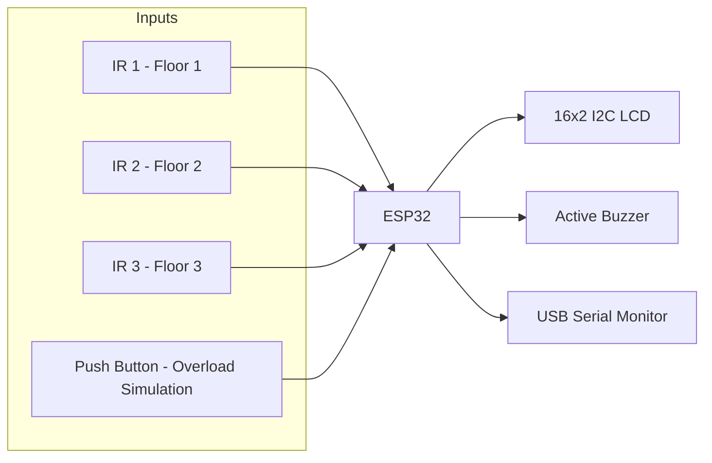

# System Architecture

## Architecture overview

The ESP32 is the central controller. Three digital IR modules provide floor-marker detection. A push button supplies a simulated overload event. The ESP32 updates the LCD and buzzer based on the inputs.

## Signal flow

1. IR sensor digital outputs are read on GPIO 13, 14, and 27.
2. Button state is read on GPIO 26 using INPUT_PULLUP.
3. The ESP32 applies the floor update and button debounce/toggle logic.
4. LCD data is sent over I²C on GPIO 21 (SDA) and GPIO 22 (SCL).
5. The buzzer is controlled by GPIO 25.

## Communication

The implemented version uses local digital GPIO and I²C communication. Although the ESP32 includes Wi-Fi capability, Wi-Fi, cloud telemetry, and mobile dashboards are not implemented in this sketch.
